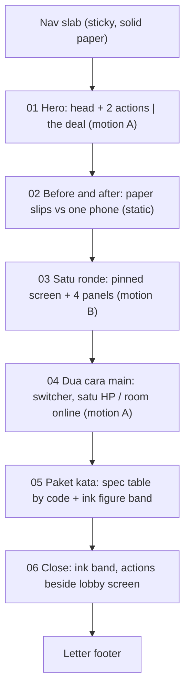

# What's The Word Landing Page Implementation Plan

> **For agentic workers:** REQUIRED SUB-SKILL: Use superpowers:subagent-driven-development (recommended) or superpowers:executing-plans to implement this plan task-by-task. Steps use checkbox (`- [ ]`) syntax for tracking.

**Goal:** Ship a structured, motion-led landing page at `/` for What's The Word, built with Hallmark (theme Terrazzo, draw 781f20), that sends visitors straight into a game (Pass & Play or an online room), while the existing app moves to `/play` untouched.

**Architecture:** No router exists today (`App.tsx` switches on a `currentView` state). We add a `LANDING` view resolved from `window.location` by a pure, tested helper, plus `history.pushState` for `/play`. The landing lives in its own folder `client/src/landing/` with a Terrazzo token block **scoped to `.lp-root`** so the app's Hum tokens in `client/src/tokens.css` are never overridden. Motion follows the Seatpax reference pattern (in-view scripted card demos + one pinned scroll chapter) but stays inside Hallmark's budget of three motion primitives.

**Tech Stack:** React 18, TypeScript, Vite 6, Tailwind 3.4 (utility layout only) + plain CSS for the landing material, `motion` 12 (`animate`, `useInView`, `useReducedMotion`), CSS `animation-timeline: view()` with an IntersectionObserver fallback, Vitest (fs + pure-function tests), Hallmark `sloplint.mjs`.

## Global Constraints

- Hallmark Floor binds every file: tokens only (no literal colours or `font-family` outside the token block), never `transition: all`, never animate `width/height/top/left`, `:focus-visible` on every control, `prefers-reduced-motion` fallback for every animation, content visible without JS, no eyebrow / tracked caps, no middle-dot meta strings, no arrows glued to link text, no card inside a card, no emoji or sparkle icons.
- Hero: headline ≤ 7 words, one sentence ≤ 12 words, two actions, all visible at 1280 × 800. About 80 words per screen max; 450 visible words for the page.
- Never invent a number, quote or logo. The only figures allowed are computed from real data (`DEFAULT_WORD_PAIRS.length`, `CATEGORIES.length - 1`, player range 3 to 20 from the game rules).
- Motion budget (exactly three primitives): **A** card-timeline demos (hero + mode switcher), **B** one pinned scroll chapter, **C** hover signal (card offset paper-3 to ink). No page-load reveal beyond primitive A.
- Terrazzo's own Motion line says "Still"; the user's explicit request for section motion overrides it (Hallmark: the user's words beat the theme). Record it in the stamp as `answered: motion by request`.
- The app (`HomePage`, Pass & Play, Lobby, RoomGame) keeps 100% of its wiring; `?room=CODE` invite links must still open the app directly, never the landing.
- All Indonesian copy, sentence case, no em/en dashes (`AntiSlopPreFlight.test.ts` scans for them).
- Final gates: `sloplint.mjs client/src --genre playful --scope app --kept` → 0 FAIL / 0 REFLEX (135/135 handlers kept), `npm test --workspace=client` green, `npm run typecheck` 0 errors, `npm run build --workspace=client` succeeds.

---

## Hallmark Picks

**Hallmark · v2.0.0**

- **Shape** · Split Studio, from draw 781f20 · genre playful (theme genre modern-minimal, tempered by the user's motion request) · job: try, the two play actions under the head and again at the close
- **Theme** · Terrazzo, dealt 3/3 (off-white paper, white plates ruled in 2px ink over a hard 14px offset, Syne heads over Onest, JetBrains Mono for codes, rust the one signal) · picked over Arcade (dark CRT would jar against the light app one click later) and Piste (needs big photographs we do not have)
- **Chrome** · nav: slab (wordmark left, two anchor links, ink "Main sekarang" right, solid paper, sticky) · footer: letter close (a short signed note from the maker over the links)
- **Hero** · Settled: head + sentence + two actions on columns 1 to 5; the signature card table on columns 7 to 12
- **Signature** · the deal: four word cards dealt onto the table, three read "Kopi", one reads "Teh" and gets the rust "penyamar" stamp; the visitor can press a card to peek
- **Sections** · Hero (the deal) · Before and after (paper slips vs one phone) · Pinned round (01 intip, 02 jelaskan, 03 voting, 04 tebakan Mr. White over real screens) · Switcher (satu HP vs room online, what each needs) · Spec table (the word pack by code, real pairs) · Close on ink band (actions beside the lobby screen) · Letter footer
- **Material** · real: 3 to 20 players, Pass & Play on one device, online rooms with a 6-character code, Mr. White, custom word packs with share codes, `DEFAULT_WORD_PAIRS` with ids like `mkn-01` · pictures: screenshots of the running app captured at 1440 and 390, the deal built in code · absent: testimonials, ratings, download counts, logos
- **Motion** · A card timelines (hero, switcher) · B pinned round chapter · C plate offset hover · reduced motion shows every end state
- **Sweep** · run after build

Reference read from the user's Seatpax landing (`Ticketing/SeatPax/app/page.tsx`, `landing/booking-motion-timeline.ts`): full-height `lp-screen` sections with a section nav that tracks the active anchor, in-view scripted demos that pause off-screen and respect reduced motion, a route that draws between steps. We keep the structure and the in-view engine idea; we drop its eyebrows (`SHUTTLE ANTARKOTA`), glued arrows and italic word in a roman head, which fail the Floor.

---

## Page Map



| # | Section | Composition (layout.md § 5) | Motion | Words |
|---|---|---|---|---|
| 01 | Hero | Split, text 5 cols / deal 7 cols | A: deal on load + press to peek | ~30 |
| 02 | Sebelum dan sesudah | Two plates side by side | none | ~50 |
| 03 | Satu ronde | Pinned, screen 7 cols sticky, 4 panels | B: scroll-linked step + screen swap | ~70 |
| 04 | Dua cara main | Switcher, segmented control | A: room code types in, avatars join | ~50 |
| 05 | Paket kata | Spec table + figure on ink band | C on rows | ~60 |
| 06 | Ajak teman | Split on ink band | none | ~25 |
| — | Footer | Letter close | none | ~40 |

---

### Task 1: Route resolution helper (TDD) and `/play` wiring

**Files:**
- Create: `client/src/utils/initialView.ts`
- Create: `client/src/tests/initialView.test.ts`
- Modify: `client/src/App.tsx`

**Interfaces:**
- Produces: `export type AppView = 'LANDING' | 'HOME' | 'PASS_PLAY' | 'ONLINE'`; `export function resolveInitialView(pathname: string, search: string): 'LANDING' | 'HOME'`; `export const PLAY_PATH = '/play'`.
- Produces for Task 7: `LandingPage` receives `onPlayLocal: () => void` and `onPlayOnline: () => void`.

- [ ] **Step 1: Write the failing test**

```ts
// client/src/tests/initialView.test.ts
import { describe, it, expect } from 'vitest';
import { resolveInitialView, PLAY_PATH } from '../utils/initialView';

describe('resolveInitialView', () => {
  it('shows the landing on the bare root', () => {
    expect(resolveInitialView('/', '')).toBe('LANDING');
  });
  it('opens the app on /play', () => {
    expect(resolveInitialView(PLAY_PATH, '')).toBe('HOME');
    expect(resolveInitialView('/play/', '')).toBe('HOME');
  });
  it('opens the app directly for invite links', () => {
    expect(resolveInitialView('/', '?room=8K29PX')).toBe('HOME');
  });
  it('falls back to the landing for unknown paths', () => {
    expect(resolveInitialView('/apa-saja', '')).toBe('LANDING');
  });
});
```

- [ ] **Step 2: Run it, expect FAIL** (`Cannot find module '../utils/initialView'`)

Run: `npm test --workspace=client -- initialView`

- [ ] **Step 3: Implement**

```ts
// client/src/utils/initialView.ts
export type AppView = 'LANDING' | 'HOME' | 'PASS_PLAY' | 'ONLINE';
export const PLAY_PATH = '/play';

export function resolveInitialView(pathname: string, search: string): 'LANDING' | 'HOME' {
  if (new URLSearchParams(search).has('room')) return 'HOME';
  const clean = pathname.replace(/\/+$/, '') || '/';
  return clean === PLAY_PATH ? 'HOME' : 'LANDING';
}
```

- [ ] **Step 4: Wire `App.tsx`** (keep every existing branch; only add the landing branch and URL sync)

```tsx
import { LandingPage } from './landing/LandingPage';
import { AppView, PLAY_PATH, resolveInitialView } from './utils/initialView';

const [currentView, setCurrentView] = useState<AppView>(() =>
  resolveInitialView(window.location.pathname, window.location.search)
);

const goToApp = (view: Exclude<AppView, 'LANDING'>) => {
  if (window.location.pathname !== PLAY_PATH) {
    window.history.pushState({}, '', PLAY_PATH + window.location.search);
  }
  setCurrentView(view);
};

useEffect(() => {
  const onPop = () => setCurrentView(resolveInitialView(window.location.pathname, window.location.search));
  window.addEventListener('popstate', onPop);
  return () => window.removeEventListener('popstate', onPop);
}, []);

// the existing room effect must not yank a visitor off the landing:
// change `if (room && currentView === 'HOME')` to stay as is (it only fires from HOME).

if (currentView === 'LANDING') {
  return <LandingPage onPlayLocal={() => goToApp('PASS_PLAY')} onPlayOnline={() => goToApp('HOME')} />;
}
```

Replace the other `setCurrentView('HOME')` calls with `goToApp('HOME')` only where the user leaves a game, so the URL stays `/play`.

- [ ] **Step 5: Run tests, expect PASS** — `npm test --workspace=client`
- [ ] **Step 6: Commit** — `git commit -m "feat(app): add landing view and /play route resolution"`

> [!NOTE]
> Production: if the server serves `client/dist`, add an SPA fallback so a hard refresh on `/play` returns `index.html`. Check `server/src` for `express.static`; today none was found, so Vite dev and any static host with SPA rewrite are enough.

---

### Task 2: Terrazzo scaffold, scoped tokens, fonts, stamp

**Files:**
- Create (via scaffold): `client/src/landing/tokens.css`, `client/src/landing/base.css`
- Create: `client/src/landing/landing.css`
- Modify: `client/package.json` (fonts)
- Test: `client/src/tests/LandingTokens.test.ts`

**Interfaces:**
- Produces: CSS custom properties available only inside `.lp-root`: `--color-paper`, `--color-paper-2`, `--color-paper-3`, `--color-plate`, `--color-ink`, `--color-ink-2`, `--color-muted`, `--color-rule`, `--color-accent`, `--color-accent-soft`, `--color-accent-ink`, `--color-focus`, `--font-display`, `--font-body`, `--font-outlier`, `--rule-hair`, `--rule-bar`, `--shadow-card`, `--shadow-card-hover`, plus the shared space/type/ease/dur scale.
- Produces classes used by every section: `.lp-root`, `.lp-container`, `.lp-screen`, `.lp-plate`, `.lp-btn`, `.lp-btn--primary`, `.lp-btn--secondary`, `.lp-band--ink`, `.lp-code`, `.lp-head`, `.lp-lead`.

- [ ] **Step 1: Scaffold into the landing folder, never the app's `src/`**

Run: `node C:\Users\ASUS\.gemini\config\skills\hallmark\scripts\theme.mjs scaffold terrazzo --dealt "3/3, seed what-word-indonesian-social-da56·f72402d9·2026-11-02·r0" --dir client/src/landing`

- [ ] **Step 2: Rescope** every `:root {` in `client/src/landing/tokens.css` and `base.css` to `.lp-root {` (a declared theme block, Floor rule 1). Keep `html, body { overflow-x: clip }` in the app's base, not here.

- [ ] **Step 3: Fonts** — `npm i @fontsource/syne @fontsource-variable/onest --workspace=client`; import in `LandingPage.tsx` only (`@fontsource/syne/700.css`, `@fontsource-variable/onest`, `@fontsource/jetbrains-mono/500.css`) so the app bundle path is unchanged.

- [ ] **Step 4: Write the failing token test**

```ts
// client/src/tests/LandingTokens.test.ts
import { describe, it, expect } from 'vitest';
import fs from 'fs';
import path from 'path';

const dir = path.resolve(__dirname, '../landing');
const read = (f: string) => fs.readFileSync(path.join(dir, f), 'utf-8');

describe('landing tokens', () => {
  it('never redeclares :root (app Hum tokens stay intact)', () => {
    expect(read('tokens.css')).not.toMatch(/:root\s*\{/);
    expect(read('base.css')).not.toMatch(/:root\s*\{/);
  });
  it('scopes Terrazzo to .lp-root', () => {
    expect(read('tokens.css')).toContain('.lp-root');
    expect(read('tokens.css')).toContain('--color-plate');
  });
  it('opens landing.css with the Hallmark stamp', () => {
    const first = read('landing.css').split('\n').find((l) => l.trim().length > 0)!;
    expect(first).toMatch(/^\/\* Hallmark/);
  });
});
```

- [ ] **Step 5: `landing.css`** — first line is the filled stamp, then the critique line, then waivers:

```css
/* Hallmark · shape: Split Studio (draw 781f20) · genre: playful · theme: Terrazzo off-white (deal 3/3, seed what-word-indonesian-social-da56·f72402d9·2026-11-02·r0) · nav: slab · footer: letter close · signature: the deal · v2.0.0 */
/* Hallmark · pre-emit critique: filled after the sweep */
/* Hallmark · answered: motion by request (theme Motion is still; user asked for section motion, budget held at 3 primitives) */
@import url("./tokens.css");
@import url("./base.css");

.lp-root { background: var(--color-paper); color: var(--color-ink); font-family: var(--font-body); }
.lp-container { max-width: var(--container); margin-inline: auto; padding-inline: clamp(20px, 5vw, var(--gutter)); }
.lp-screen { padding-block: var(--section-gap-s); scroll-margin-top: 72px; }
.lp-head { font-family: var(--font-display); font-weight: 700; line-height: 1; letter-spacing: var(--tracking-display); overflow-wrap: break-word; min-width: 0; }
.lp-plate { background: var(--color-plate); border: var(--rule-bar) solid var(--color-ink); box-shadow: var(--shadow-card); border-radius: 0; }
a.lp-plate, button.lp-plate { transition: box-shadow var(--dur-micro) var(--ease-out); }
a.lp-plate:hover, button.lp-plate:hover { box-shadow: var(--shadow-card-hover); }
.lp-btn { display: inline-flex; align-items: center; min-height: 48px; padding: var(--space-md) var(--space-lg); font-weight: 500; border-radius: 0; transition: background-color var(--dur-micro) var(--ease-out), color var(--dur-micro) var(--ease-out); }
.lp-btn--primary { background: var(--color-ink); color: var(--color-paper); }
.lp-btn--secondary { box-shadow: inset 0 0 0 var(--rule-bar) currentColor; }
.lp-btn:focus-visible, .lp-root a:focus-visible, .lp-root button:focus-visible { outline: 3px solid var(--color-focus); outline-offset: 3px; transition: none; }
.lp-btn:disabled { opacity: 0.5; cursor: not-allowed; }
.lp-band--ink { background: var(--color-ink); color: var(--color-paper); }
.lp-band--ink .lp-btn--primary { background: var(--color-plate); color: var(--color-ink); }
.lp-code { font-family: var(--font-outlier); font-weight: 500; font-variant-numeric: tabular-nums; }
```

- [ ] **Step 6: Run tests, expect PASS; commit** — `git commit -m "feat(landing): scaffold scoped Terrazzo tokens and landing stylesheet"`

---

### Task 3: Real screenshots of the app

**Files:**
- Create: `client/public/landing/screens/*.png` (reveal, describe, voting, mrwhite, lobby, setup at 1440 and 390)

- [ ] **Step 1:** `capture.mjs` needs puppeteer; install it in a scratch folder, not the project: `npm i puppeteer-core --prefix C:\Users\ASUS\.gemini\antigravity\brain\716131a8-7bc5-4184-86a2-6492e098b412\scratch\pptr`, then set `$env:HALLMARK_PUPPETEER` to that folder.
- [ ] **Step 2:** With Vite (5173) and the game server (3002) running, drive each state (Pass & Play with 4 players: setup, secret reveal, discussion, voting, Mr. White guess; one online lobby with a room code) and capture with `--selector` on the main panel: `node <skill>/scripts/capture.mjs http://localhost:5173/play --out client/public/landing/screens --name reveal --sizes desktop,phone --wait 1200`. States that need clicks are captured through a browser subagent if the script cannot reach them.
- [ ] **Step 3:** Check each PNG for a leaked secret word on the "before peek" frames; commit. — `git commit -m "chore(landing): add real app captures"`

---

### Task 4: Motion primitive A, the card timeline hook

**Files:**
- Create: `client/src/landing/useCardTimeline.ts`
- Test: `client/src/tests/LandingMotion.test.ts`

**Interfaces:**
- Produces: `useCardTimeline(ref: RefObject<HTMLElement>, build: (scope: HTMLElement) => AnimationSequence, opts?: { loop?: boolean; amount?: number }): { replay: () => void; isStatic: boolean }`. Plays once when 35% of the element is in view (Seatpax threshold), pauses when off-screen, and jumps straight to the end state under reduced motion.

- [ ] **Step 1: Failing static test** (behaviour contract readable without a DOM)

```ts
// client/src/tests/LandingMotion.test.ts
import { describe, it, expect } from 'vitest';
import fs from 'fs';
import path from 'path';

const src = fs.readFileSync(path.resolve(__dirname, '../landing/useCardTimeline.ts'), 'utf-8');

describe('useCardTimeline contract', () => {
  it('respects reduced motion', () => expect(src).toContain('useReducedMotion'));
  it('starts in view, not on scroll listeners', () => {
    expect(src).toContain('useInView');
    expect(src).not.toContain("addEventListener('scroll'");
  });
  it('only animates transform and opacity', () => {
    expect(src).not.toMatch(/\b(width|height|top|left)\s*:/);
  });
});
```

- [ ] **Step 2: Implement**

```ts
// client/src/landing/useCardTimeline.ts
import { RefObject, useCallback, useEffect, useRef } from 'react';
import { animate, useInView, useReducedMotion, type AnimationPlaybackControls, type AnimationSequence } from 'motion/react';

export function useCardTimeline(
  ref: RefObject<HTMLElement>,
  build: (scope: HTMLElement) => AnimationSequence,
  opts: { loop?: boolean; amount?: number } = {}
) {
  const reduce = useReducedMotion() ?? false;
  const inView = useInView(ref, { amount: opts.amount ?? 0.35 });
  const controls = useRef<AnimationPlaybackControls | null>(null);
  const played = useRef(false);

  const play = useCallback(() => {
    const el = ref.current;
    if (!el) return;
    controls.current?.stop();
    controls.current = animate(build(el), { repeat: opts.loop ? Infinity : 0, repeatDelay: 2.4 });
    if (reduce) controls.current.complete();
  }, [build, opts.loop, reduce, ref]);

  useEffect(() => {
    if (inView && !played.current) { played.current = true; play(); }
    else if (inView) controls.current?.play();
    else controls.current?.pause();
  }, [inView, play]);

  useEffect(() => () => controls.current?.stop(), []);
  return { replay: play, isStatic: reduce };
}
```

Base CSS always shows the finished layout; the sequence animates *from* offsets with `{ at: ... }` keyframes, so no-JS and reduced motion see the end state.

- [ ] **Step 3: Tests pass; commit** — `git commit -m "feat(landing): add in-view card timeline hook"`

---

### Task 5: Nav slab and Hero with the deal (signature)

**Files:**
- Create: `client/src/landing/LandingNav.tsx`, `client/src/landing/HeroDeal.tsx`, `client/src/landing/content.ts`

**Interfaces:**
- Consumes: `useCardTimeline` (Task 4), `onPlayLocal`, `onPlayOnline` (Task 1).
- Produces: `content.ts` exports `HERO`, `ROUND_STEPS`, `MODES`, `BEFORE_AFTER`, `SAMPLE_PAIRS` (first 8 of `DEFAULT_WORD_PAIRS`), `PAIR_COUNT = DEFAULT_WORD_PAIRS.length`, `CATEGORY_COUNT = CATEGORIES.length - 1`.

- [ ] **Step 1: Copy (content.ts)**

```ts
export const HERO = {
  title: 'Satu kata beda. Siapa orangnya?',          // 5 words
  sentence: 'Game tebak penyamar untuk 3 sampai 20 teman, cukup satu HP.', // 11 words
  primary: 'Main di satu HP',
  secondary: 'Buat room online',
};
```

- [ ] **Step 2: Nav slab** — `<header className="lp-nav">` sticky, solid `--color-paper` with a `--rule-bar` bottom rule (no transparency, the bleed-through bug fixed earlier must not return), wordmark "What's The Word", anchors "Cara main" (`#ronde`) and "Mode" (`#mode`), ink primary "Main sekarang" calling `onPlayLocal`. Active anchor tracked with one IntersectionObserver over `[data-landing-section]` (the Seatpax idea, without its scroll listener). Under 40rem the anchors fold away; the primary stays.

- [ ] **Step 3: Hero layout** — `grid-template-columns: minmax(0,5fr) minmax(0,7fr)`; left: `h1.lp-head` at `clamp(2.6rem, 5.4vw, 4.6rem)`, the sentence, the two `.lp-btn`s, then one mono fact line `3 sampai 20 pemain` / `tanpa akun` as two plain lines (no dots). Right: the table.

- [ ] **Step 4: The deal** — four `.lp-plate` cards (`aspect-ratio: 5/7`, 150 to 190px wide) fanned on the table. Each card front shows a mono code (`mkn-01`) top left and the word at title size; three say "Kopi", one says "Teh". Sequence:

```ts
const deal = (scope: HTMLElement): AnimationSequence => [
  ...[0, 1, 2, 3].map((i) => [
    scope.querySelector(`[data-card="${i}"]`)!,
    { opacity: [0, 1], x: [-220 + i * 40, 0], y: [-60, 0], rotate: [-14, (i - 1.5) * 6] },
    { duration: 0.55, ease: [0.34, 1.56, 0.64, 1], at: i * 0.12 },
  ] as const),
  [scope.querySelector('[data-cover]')!, { opacity: [1, 0] }, { duration: 0.25, at: 1.0 }],            // envelope flaps lift
  [scope.querySelector('[data-card="2"]')!, { y: [0, -18, 0] }, { duration: 0.5, at: 1.4 }],           // the odd one hops
  [scope.querySelector('[data-stamp]')!, { opacity: [0, 1], scale: [1.4, 1], rotate: [-18, -8] }, { duration: 0.32, ease: [0.22, 1, 0.36, 1], at: 1.8 }],
];
```

Pressing a card (`button`, `aria-pressed`) peeks it: a `y: -24` lift with the spring ease, word revealed; keyboard Space/Enter does the same. `aria-live="polite"` caption under the table reads "Tiga kartu Kopi, satu kartu Teh. Yang pegang Teh adalah penyamar." Reduced motion: cards rest fanned, stamp visible.

- [ ] **Step 5:** `node <skill>/scripts/sloplint.mjs client/src/landing --genre playful --render --stage hero --url http://localhost:5173/`; fix every FAIL; run the hero review in a fresh subagent (`gates.md` § 6, the reviewer reads `review-hero.md`, not us).
- [ ] **Step 6: Commit** — `git commit -m "feat(landing): nav slab and hero with the deal signature"`

---

### Task 6: Sections 02 to 06 and the letter footer

**Files:**
- Create: `client/src/landing/BeforeAfter.tsx`, `RoundPinned.tsx`, `ModeSwitcher.tsx`, `WordPackTable.tsx`, `LandingClose.tsx`, `LandingFooter.tsx`

**Interfaces:**
- Consumes: `content.ts`, captures from Task 3, `useCardTimeline`.

- [ ] **Step 1: 02 Sebelum dan sesudah** (static, two plates side by side, one column gap)
  - Head: "Tanpa kertas, tanpa juri."
  - Left plate "Dulu": "Tulis kata di sobekan kertas, satu orang jadi juri dan tidak ikut main, kertasnya ketahuan dari belakang."
  - Right plate "Sekarang": "HP membagikan kata secara acak, semua orang ikut main, dan kata baru terlihat saat kartunya kamu tahan."

- [ ] **Step 2: 03 Satu ronde** — Pinned composition, primitive B.
  - Structure: `section#ronde.lp-chapter` (min-height 300vh desktop) holding a grid: left 7 cols sticky `figure` with four stacked captures (`reveal`, `describe`, `voting`, `mrwhite`) inside one `.lp-plate`; right 5 cols the ordered list.
  - Steps (Syne numerals at section size, Onest 500 stage, one line):
    1. `01` Intip kata: "Tahan kartu, lihat katamu, oper HP ke teman."
    2. `02` Jelaskan: "Tiap orang kasih satu petunjuk tanpa menyebut katanya."
    3. `03` Voting: "Pilih siapa yang paling mencurigakan. Suara terbanyak keluar."
    4. `04` Tebakan Mr. White: "Mr. White tidak punya kata. Kalau tebakannya benar, dia menang."
  - CSS from `scroll-choreography.md` § 1: named `view-timeline: --ronde`, `li` ranges `contain 5–30 / 30–55 / 55–80 / 80–100%`, the matching capture fades `opacity` 0 → 1 on the same ranges. All inside `@supports (animation-timeline: view())` and `@media (prefers-reduced-motion: no-preference) and (min-width: 40rem)`; easing `linear`. Base CSS: all four steps at full opacity and the first capture shown; under 60rem it unpins into step, capture, step, capture.
  - JS fallback only when `!CSS.supports('animation-timeline: view()')`: IntersectionObserver adds `.is-active` per step (reveal-once, `--dur-long --ease-out`), never a scroll listener.

- [ ] **Step 3: 04 Dua cara main** — Switcher (`role="tablist"`), primitive A.
  - Tab "Satu HP": what it needs: 1 HP, 3 sampai 20 pemain, tanpa internet setelah halaman terbuka (verify offline behaviour before keeping that last line; drop it if not true). Visual: the `setup` capture in a plate.
  - Tab "Room online": what it needs: tiap orang pegang HP, satu kode room 6 karakter, host atur kategori dan jumlah penyamar. Visual: a built lobby plate where the code `8K29PX` types in letter by letter (`lp-code`) and four avatars drop into the list with the spring ease, via `useCardTimeline` started on tab activation.
  - Both panels are in the DOM; the first is visible without script. Each panel ends with its own `.lp-btn--primary` (`onPlayLocal` / `onPlayOnline`).

- [ ] **Step 4: 05 Paket kata** — Terrazzo's specification table + figure on ink band.
  - Ink band figure: `{PAIR_COUNT}` in Syne at twice `--text-display` beside a ruled list of the real categories (`CATEGORIES.slice(1)`), caption "pasangan kata bawaan".
  - Table under a 2px ink rule: columns Kode (`mkn-01` in mono), Kata warga, Kata penyamar, Kategori (muted). Eight real rows from `SAMPLE_PAIRS`. Row hover: `--color-accent-soft` background and rust code (primitive C family).
  - One line under the table: "Punya kata sendiri? Buat paket kustom dan bagikan kodenya." with a hairline-underlined link that calls `onPlayOnline` (no glued arrow).

- [ ] **Step 5: 06 Ajak teman** — ink band, Split: left head "Kumpulkan teman. Satu HP cukup." + both actions (plate primary on ink); right the `lobby` capture in a plate.

- [ ] **Step 6: Letter footer** — a short signed note set like a letter ("Dibuat untuk malam main bareng teman. Kalau ada kata yang terlalu gampang, buat paketmu sendiri." signed with the maker's name, which we ask the user for; until then the signature line is a visible slot), then plain links: Main sekarang, Cara main, Mode.

- [ ] **Step 7: Assemble `LandingPage.tsx`**

```tsx
import '@fontsource/syne/700.css';
import '@fontsource-variable/onest';
import '@fontsource/jetbrains-mono/500.css';
import './landing.css';

export const LandingPage: React.FC<{ onPlayLocal: () => void; onPlayOnline: () => void }> = (p) => (
  <div className="lp-root">
    <LandingNav {...p} />
    <main>
      <HeroDeal {...p} />
      <BeforeAfter />
      <RoundPinned />
      <ModeSwitcher {...p} />
      <WordPackTable onPlayOnline={p.onPlayOnline} />
      <LandingClose {...p} />
    </main>
    <LandingFooter onPlayLocal={p.onPlayLocal} />
  </div>
);
```

- [ ] **Step 8: Commit** — `git commit -m "feat(landing): sections, pinned round, mode switcher, word pack table, close"`

---

### Task 7: Landing regression tests

**Files:**
- Create: `client/src/tests/LandingPage.test.ts`

- [ ] **Step 1: Write the tests**

```ts
import { describe, it, expect } from 'vitest';
import fs from 'fs';
import path from 'path';
import { HERO } from '../landing/content';

const dir = path.resolve(__dirname, '../landing');
const all = fs.readdirSync(dir).filter((f) => /\.(tsx|ts|css)$/.test(f))
  .map((f) => fs.readFileSync(path.join(dir, f), 'utf-8')).join('\n');

describe('landing page floor', () => {
  it('hero headline is 7 words or fewer, sentence 12 or fewer', () => {
    expect(HERO.title.split(/\s+/).length).toBeLessThanOrEqual(7);
    expect(HERO.sentence.split(/\s+/).length).toBeLessThanOrEqual(12);
  });
  it('has no sparkle icons, eyebrows or tracked caps', () => {
    expect(all).not.toContain('Sparkle');
    expect(all).not.toMatch(/tracking-widest|uppercase/);
  });
  it('never uses transition: all', () => expect(all).not.toMatch(/transition:\s*all/));
  it('guards scroll choreography behind support and reduced motion', () => {
    expect(all).toContain('@supports (animation-timeline: view())');
    expect(all).toContain('prefers-reduced-motion: no-preference');
  });
  it('invents no testimonial or rating', () => {
    expect(all).not.toMatch(/testimoni|rating|bintang 5|ribuan pemain/i);
  });
});
```

- [ ] **Step 2: Run, expect PASS; commit** — `git commit -m "test(landing): floor regression tests"`

---

### Task 8: Sweep and hand-off

- [ ] **Step 1:** `node <skill>/scripts/sloplint.mjs client/src --genre playful --scope app --kept` and `node <skill>/scripts/sloplint.mjs client/src/landing --genre playful --render --url http://localhost:5173/`; fix every FAIL, fix or waive every REFLEX in the stamp.
- [ ] **Step 2:** Load `gates.md` § 5, walk the J and R/J gates, confirm or dismiss every WARN.
- [ ] **Step 3:** Finish review in a fresh subagent (`gates.md` § 6); act on its first word (`recapture`, `rebuild`, `fix`, `ship`).
- [ ] **Step 4:** Check 1280 × 800 (hero fits), 390 × 844 (pinned unpins, switcher stacks), 1920 (gutters grow, measure does not).
- [ ] **Step 5:** `npm test --workspace=client`, `npm run typecheck`, `npm run build --workspace=client`.
- [ ] **Step 6:** Log: `node <skill>/scripts/theme.mjs log --entry '{"shape":"split-studio","theme":"terrazzo","axes":"light/geometric-sans/warm","hero":"settled","nav":"slab","footer":"letter close","imagery":"product captures","signature":"the deal","sections":["hero","before-after","pinned","switcher","spec-table","close"],"prompt":"landing page What\u0027s The Word"}' --log .hallmark/log.json`
- [ ] **Step 7:** Fill the critique line in the stamp; update the Picks block's Sweep row with the real outcome; commit — `git commit -m "feat(landing): Hallmark sweep clean"`
- [ ] **Step 8:** Material ask to the user: the maker's name for the letter footer, and one real photo of friends playing (the piece that would most improve the page).

---

## Open Decisions for the User

1. **Theme**: Terrazzo (recommended, light, square cards, mono codes) vs Arcade (dark CRT game marquee, louder, but a jump in mood when entering the light app).
2. **Footer signature**: whose name signs the letter close?
3. **Offline claim** in the Satu HP tab: keep only if Pass & Play truly works offline after load.
